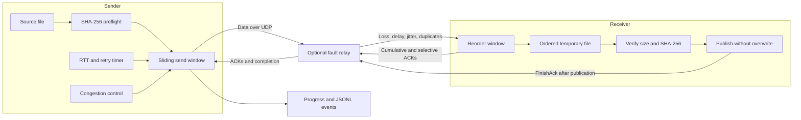

# Ripple

**A reliable file-transfer protocol built over UDP in Go.** Watch packets get lost,
retransmitted, acknowledged, and reassembled into a verified file.

Ripple implements selective acknowledgements, adaptive retransmission timers,
slow start, and additive-increase congestion control. Its fault relay adds loss,
delay, jitter, duplication, and corruption so you can see how recovery works.
The binary has **zero third-party Go dependencies**.

[Implementation plan](docs/PLAN.md) · [Detailed architecture](docs/ARCHITECTURE.md) ·
[Verification](docs/VERIFICATION.md) · [MIT license](LICENSE)

## Architecture



Without the relay, the endpoints communicate directly. Each process handles one
transfer. Payload memory is bounded by a window of at most 64 packets.
[Read the protocol and state-machine details →](docs/ARCHITECTURE.md)

## Build and try it

Requires **Go 1.24+** on macOS or Linux. Race tests also require a C compiler.
Python 3.9+ and Make are optional helpers for the reproducible demo.

```sh
git clone https://github.com/rushikeshg25/ripple.git
cd ripple
go build -o bin/ripple ./cmd/ripple
```

In one terminal, start a receiver with a new output path:

```sh
./bin/ripple receive -listen 127.0.0.1:9000 -out received.bin
```

In another terminal, send a regular file:

```sh
./bin/ripple send -to 127.0.0.1:9000 -file README.md
```

The receiver publishes the file only after its size and hash match. It then stays
alive for six seconds to answer repeated completion messages before exiting.
The output path must not already exist, and its parent directory must exist.

## Break the network

Start a fresh receiver, then run the relay in a second terminal:

```sh
./bin/ripple relay -listen 127.0.0.1:9001 -to 127.0.0.1:9000 \
  -loss 0.05 -delay 10ms -jitter 5ms -duplicate 0.02 -seed 7
```

Send to the **relay's port** from a third terminal:

```sh
./bin/ripple send -to 127.0.0.1:9001 -file README.md \
  -events send.jsonl -json
```

Faults apply in both directions, including ACKs and handshake messages. Add
`-corrupt 0.01` to flip one bit in approximately 1% of queued copies. Stop the
relay with Ctrl-C to print its counters. Restart it for each new client run.

For a complete demonstration using a generated 256 KiB file and free local ports:

```sh
make demo
# Or, after building:
python3 scripts/demo.py
```

The demo verifies hashes, packet recovery, existing-file protection, and interrupt
cleanup. Each run writes to a new directory under `demo-output/`, preserving prior
runs. `result.json` contains summaries and retransmitted sequence numbers; JSONL
files contain packet events. Timing and retry counts can vary despite a fixed seed.

## What the metrics mean

Progress appears on stderr. The final summary appears on stdout; `-json` makes
that summary machine-readable. `-events PATH` records every transport event in a
new JSONL file. `-quiet` suppresses progress lines.

- `cwnd`: congestion allowance in packets; decreases after a timeout.
- `flight`: sent packets whose payloads remain unacknowledged.
- `rtt`: smoothed round-trip time from packets that were not retransmitted.
- `rto`: current data retransmission timeout.
- `retries`: data and control retransmissions by the sender.
- `rate`: payload progress since the previous terminal update, not wire bandwidth.

RTT and congestion metrics belong to the sender. Receiver elapsed time includes
its completion linger. Invalid-packet counts also include harmless stale ACKs.
See [observability details](docs/ARCHITECTURE.md#11-configuration-and-observability).

## Limits and guarantees

- One file, one peer, one session per process; IPv4 and IPv6 addresses are supported.
- Default maximum file size: **1 GiB**. Set `-max-size` on both endpoints to change it.
- Default window: **32 packets**. Set `-window 1..64` to experiment.
- Default idle timeout: **15 seconds without progress**; change with `-idle-timeout`.
- Source files must stay unchanged. The sender checks streamed size and SHA-256.
- Existing destinations are never overwritten, including concurrent creations.
- Publication requires same-filesystem hard-link support. File contents are synced;
  directory crash durability is not promised.
- If every final ACK is lost, the sender can report failure after the receiver has
  published the correct file. Check the hash before retrying.

This is a **learning transport for loopback or trusted isolated networks**. It has
no authentication or encryption. CRC32 and SHA-256 do not authenticate a peer.
It does not implement NAT traversal, resumption, pacing, or full TCP congestion
behavior. Use established secure transports for production traffic.

## Development

```sh
make check   # formatting, go vet, race-enabled tests
make build   # bin/ripple
make fuzz    # bounded packet-parser fuzz run
make demo    # separate-process test through the fault relay
```

Tests need no external services or elevated network privileges. The CI workflow
runs checks and the process demo on Ubuntu and macOS. Read [the plan](docs/PLAN.md)
for the 21-commit implementation sequence and explicit acceptance criteria.
