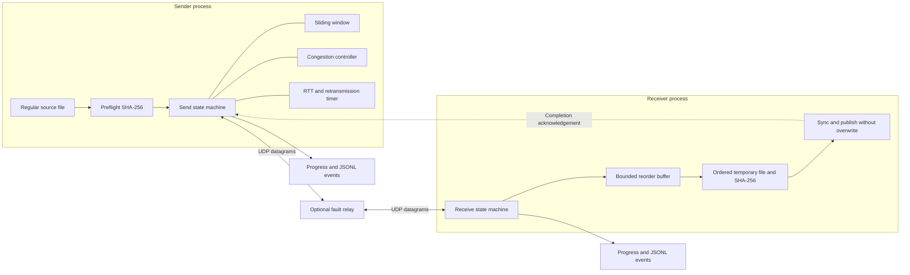

# Ripple architecture

## 1. Purpose and operating model

Ripple makes transport reliability visible. It transfers a regular file over UDP
while implementing the delivery guarantees that a TCP socket normally supplies.
The primary result is an understandable protocol with executable failure cases.
It is not TCP-compatible, QUIC-compatible, or a production networking library.

A run contains two endpoint processes and, optionally, a fault relay. Each receiver
accepts one session and exits. Each relay pins one client until stopped. There is
no background daemon, coordinator, database, account system, or cloud dependency.
The Go binary uses only the standard library. Python is needed only for the demo.

The dashed completion arrow is logical: its datagram follows the same UDP path,
including the relay when one is present. Direct transfers omit the relay.

## 2. Module boundaries

| Module | Owns | Does not own |
| --- | --- | --- |
| `cmd/ripple` | Process signals and exit status | Protocol state |
| `internal/cli` | Flag validation, socket creation, file lifecycle, progress output | Loss recovery algorithms |
| `internal/wire` | Versioned packet encoding, CRC checks, metadata bounds | Network I/O, sessions, files |
| `internal/transport` | Sender/receiver state machines, ACKs, timers, flow/congestion windows | File paths or remote filenames |
| `internal/fileio` | Source hashing, temporary files, atomic no-clobber publication | Transport retries |
| `internal/relay` | Seeded faults, peer pinning, bounded delivery queue | Reliability or acknowledgement generation |
| `scripts/demo.py` | Disposable process orchestration and result verification | Protocol implementation |

Transport entry points are `Send` and `Receive`. These are internal APIs and are
not a supported external Go module API. Their callers supply the UDP socket,
reader/writer, and validated configuration. Callers retain ownership of sockets.
A receiver publication callback separates protocol completion from file naming.

## 3. Concurrency and ownership

Each endpoint runs its protocol state in one synchronous loop. No goroutine can
concurrently mutate its window, timer, hash, or statistics. Socket reads have short
deadlines so the loop can check timeouts and context cancellation. Datagram writes
also have a deadline. These loops do not create a goroutine per packet.

The relay uses one loop and a min-heap ordered by delivery time, with insertion
order breaking ties. It checks due deliveries before reading the next datagram.
There is no unbounded channel between ingestion and delivery.

Observers run synchronously. The CLI records events and throttles terminal output
to roughly four updates per second, plus terminal lifecycle events. An output
failure cancels the operation and is returned to the caller. Slow filesystems,
readers, writers, or observers can delay the protocol: context cancellation does
not preempt an operating-system file call already in progress.

## 4. Establishing a session

1. The CLI opens a regular source file, enforces its configured size limit, hashes
   it with SHA-256, and rewinds the same file descriptor.
2. The sender generates a nonzero random 64-bit session identifier. `Hello` carries
   the exact size and expected hash. It carries no remote path or filename.
3. The receiver waits for a structurally valid `Hello` within its size limit.
   It pins the source IP, port, zone, and session ID only after these checks pass.
4. The receiver returns `HelloAck` with its receive-window capacity.
5. The sender uses the smaller of its own window and the advertised capacity.

Lost Hello or HelloAck messages cause bounded retries. A duplicate matching Hello
receives another HelloAck and never resets the receiver or rewrites output.
A Hello with changed metadata is rejected after the session is established.
Foreign traffic cannot switch an established session to a new source or identifier.
This association is a consistency check, not cryptographic authentication.

## 5. Packet layout

All integers use network byte order. A datagram is at most 1200 bytes: a 40-byte
header and up to 1160 payload bytes. The fixed size avoids IP fragmentation on
many ordinary paths, but Ripple does not discover path MTU or guarantee this on
every network. Protocol version 1 is implemented in `internal/wire/packet.go`.

| Byte offset | Length | Field |
| --- | --- | --- |
| 0 | 4 | ASCII magic `RPL1` |
| 4 | 1 | Version, currently `1` |
| 5 | 1 | Packet kind, `1` through `6` |
| 6 | 2 | Reserved, must be zero |
| 8 | 8 | Nonzero session ID |
| 16 | 4 | Data sequence number |
| 20 | 4 | Cumulative acknowledgement: next needed sequence |
| 24 | 8 | Selective acknowledgement bitmap |
| 32 | 2 | Exact payload length |
| 34 | 2 | Reserved, must be zero |
| 36 | 4 | IEEE CRC32 of header bytes 0–35 followed by the payload |
| 40 | Variable | Payload |

The checksum excludes its own four bytes. Parsing rejects bad magic, version,
reserved bytes, checksum, session ID, kind, payload length, truncation, and oversize
datagrams. Parsed payloads own their storage. A reusable socket buffer cannot
silently change a packet retained in the reorder window.

| Kind | Value | Payload and field rules |
| --- | --- | --- |
| Hello | 1 | 8-byte size and 32-byte SHA-256; sequence/ACK/SACK zero |
| HelloAck | 2 | One-byte window in `1..64`; sequence/ACK/SACK zero |
| Data | 3 | File chunk; sequence identifies its offset; ACK/SACK zero |
| Ack | 4 | No payload; sequence zero; cumulative ACK and SACK populated |
| Finish | 5 | No payload; sequence/ACK/SACK zero |
| FinishAck | 6 | No payload; sequence/SACK zero; ACK equals total packet count |

The codec checks structure. Endpoint state machines enforce packet-specific fields.
A future incompatible layout needs a new version; unknown versions are rejected.
There is no feature-negotiation extension or downgrade fallback.

## 6. Sequence numbers, flow control, and reassembly

Data begins at sequence zero. Sequence `s` represents byte offset `s × 1160`.
Every chunk except the final one has exactly 1160 bytes. The receiver derives the
expected final length from the handshake. Empty files have zero data packets.

Let `next` be the receiver's next missing sequence. Its ACK promises that all
sequences below `next` have been written in order. SACK bit `i` means sequence
`next + i` has been buffered. For example, if `next=2` and packets 4 and 5 are
buffered, the ACK is `2` and the bitmap is `0b1100`. Packets 2 and 3 remain missing.

Receiver rules:

- Accept only the sequence interval `[next, next + window)` and exact chunk lengths.
- Copy each new chunk into the reorder map once.
- Drain consecutive chunks to the output writer, updating SHA-256 in file order.
- Re-ACK duplicate data without writing or hashing it again.
- ACK the current state even when a correctly shaped chunk is outside the window.
- Treat writer errors and short writes as fatal; never acknowledge publication.

Sender rules:

- Retain each unacknowledged payload with its last-send timestamp and attempt count.
- Limit new data by both congestion allowance and the receive sequence interval.
- Free retained payloads when cumulative or selective ACKs confirm them.
- Do not move the sequence interval forward merely because SACK freed memory.
- Validate the entire ACK before mutation. Claims about unsent packets are invalid.
- Ignore stale cumulative ACKs and their old bitmaps.
- Count only newly acknowledged packets toward congestion growth and byte totals.

Each endpoint retains at most 64 payloads, approximately 74 KiB plus metadata,
parser/transient copies, hashes, and operating-system socket buffers. Files are
streamed rather than loaded into memory. The protocol limit is
`(2^32 - 1) × 1160` bytes; the default operational cap is **1 GiB**. Packet numbers
never wrap within a supported transfer.

## 7. RTT estimation and retransmission

Ripple uses the smoothing weights from RFC 6298 with shorter lab-oriented bounds.
It does not claim TCP compliance.

For the first valid sample `R`:

- `SRTT = R`
- `RTTVAR = R / 2`

For later samples, update variation before changing the smoothed RTT:

- `RTTVAR = 3/4 × RTTVAR + 1/4 × abs(SRTT - R)`
- `SRTT = 7/8 × SRTT + 1/8 × R`
- `RTO = clamp(SRTT + max(1ms, 4 × RTTVAR), minimum, maximum)`

Karn's rule excludes retransmitted packets from sampling because an ACK cannot
identify which transmission it answered. A timeout selects the oldest expired
retained packet and retransmits it. During a recovery interval, other expired
packets can be retried without repeatedly reducing the congestion window. A new
loss episode doubles RTO up to its maximum and starts another recovery interval.
New unambiguous RTT samples may update the timer again.

Default timers are 200 ms initially, 100 ms minimum, and 2 s maximum. Each packet
allows 12 retransmissions after its initial send. Control exchanges independently
start at 200 ms and double up to 2 s. An idle timeout of 15 s bounds lack of progress
in addition to retry counts. These defaults are aimed at a local learning lab.

## 8. Congestion control

The congestion window starts at one packet. A new ACK increases it by one packet
during slow start. After the threshold, each newly acknowledged packet increases
the window by `1 / cwnd`, approximately one packet per full window of ACKs.

A timeout sets the threshold to `max(2, cwnd / 2)` and returns the window to one.
Admission rounds the window down and caps it at the negotiated receive capacity.
Existing outstanding packets are not discarded when the window shrinks; admission
waits for enough progress. Duplicate ACKs do not inflate the window.

This is a deliberately limited congestion experiment. There is no pacing, fast
retransmit, fast recovery, ECN, bandwidth model, or demonstrated TCP fairness.
Do not interpret successful LAN tests as evidence of safe Internet-scale behavior.

## 9. Completion and filesystem semantics

After all data is acknowledged, the sender checks for an extra source byte and
compares its streamed hash with the preflight hash. Truncated, extended, or changed
content prevents it from sending Finish. The receiver also independently checks
the total length and ordered hash when Finish arrives.

The CLI's receiver writes a mode-0600 temporary file in the destination directory.
Only after successful verification does its publication callback:

1. Sync the file contents.
2. Close the temporary file.
3. Create a hard link at the final path, which fails atomically if that path exists.
4. Remove the temporary link.

A preliminary existence check improves errors, but the exclusive hard-link step
provides the no-clobber guarantee even if another process creates the path later.
A pre-existing symlink is also rejected. There is no rename-with-overwrite fallback.
Filesystems without hard-link support produce an explicit publication error.
Parent directories must already exist. Original permissions and timestamps are
not transferred. Directory crash durability is not promised.

The receiver sends FinishAck **after publication**, then lingers for six seconds,
answering repeated Finish packets without publishing again. The sender succeeds
only after it receives the matching FinishAck. Both sides eventually stop under
continued loss. This cannot provide perfect mutual knowledge: the destination may
be published even when every FinishAck is lost and the sender reports failure.

Interrupts and errors remove only temporary output. Cancellation after publication
preserves the final file. A process crash or SIGKILL may leave a `.ripple-*.part`
file; it is never automatically treated as a completed transfer. A failure after
the hard link succeeds can leave a valid published file alongside a reported error.
Check the destination hash before deciding whether a failed transfer needs retrying.

## 10. Fault relay

The relay identifies the upstream by configured address and pins its first valid
Hello client. It applies the same probabilities independently to both directions.
For each input datagram it first chooses loss, then duplication. Each retained copy
can be corrupted by flipping one randomly selected bit. Its delivery delay is:

`max(0, base delay + uniform(-jitter, +jitter))`

Independent delays can reorder packets. A priority queue holds at most 4096 copies
by default, with a configurable ceiling of 65536. Overflow drops are counted
separately. A seed reproduces PRNG choices for the same arrival sequence; OS timing,
ACK ordering, and retransmissions can change that sequence, so it is not a replay
engine. The transport test suite uses an explicit fault schedule when exact phase
coverage matters.

The relay has no bandwidth shaper, persistent queue, multi-client routing, or
transport awareness after client selection. Restart it for each new client run.
SIGINT/SIGTERM stops it, discards pending copies, and prints its counters.

## 11. Configuration and observability

`transport.DefaultConfig` is the source of truth. CLI flags override only the
window, idle timeout, and file-size cap. RTO/retry/linger controls are internal
configuration used by tests, and are not negotiated on the wire. Internal callers
must keep receiver linger compatible with the sender's maximum RTO. Configurations
are fixed for a session; there is no environment override or runtime reload.

`-events PATH` creates a new JSONL file and refuses to overwrite one. Records have
`time`, `event`, `seq`, and a value-copy `stats` object. Event names include
`listening`, `connected`, `sent`, `ack`, `received`, `retransmit`, `control_retry`,
`published`, `complete`, and `error`.

- Sender `bytes`: unique acknowledged payload bytes, including selective ACKs.
- Receiver `bytes`: bytes written in order, excluding buffered gaps.
- `retransmissions`: sender data and control retries; receiver replies are not
  classified as retransmissions.
- `invalid_packets`: parse errors and state-rejected traffic; can include harmless
  stale ACKs, foreign sessions, or delayed control packets, not just corruption.
- RTT/RTO/congestion/in-flight fields describe the sender; receiver fields stay zero.
- Sender elapsed time excludes preflight hashing. Receiver elapsed time includes
  waiting for Hello and the six-second completion linger.
- Terminal rate uses byte progress since the previous displayed update. It is not
  wire bandwidth and can show zero while the receiver lingers after publication.

Errors go to stderr and produce a nonzero exit. `-json` changes only the successful
final stdout summary. Progress stays on stderr; `-quiet` suppresses progress but
retains the receiver's readiness address. No credentials or file contents appear
in telemetry; file hashes and operational metadata are recorded.

## 12. Verification and explicit limits

See [the plan](PLAN.md) for delivery milestones and [verification](VERIFICATION.md)
for recorded results. Tests cover the wire parser, metadata, window invariants,
RTT/Karn/backoff rules, congestion behavior, real UDP transfers, fault recovery,
publication failure, source mutation, idle deadlines, IPv6 loopback when available,
filesystem races, CLI validation, and telemetry failure.

The demo adds process-level proof: generated files, ephemeral loopback ports,
lossy transfer, matching SHA-256, no-overwrite behavior, and SIGTERM cleanup.
CI runs tests and the demo on Linux and macOS. Tests do not establish behavior on
a physical lossy network, under NAT, on every filesystem, or under power loss.

There is no authentication, encryption, resumption, NAT traversal, multi-stream
multiplexing, rate guarantee, or anti-abuse handshake. The first valid Hello can
claim a receiver. CRC32 and SHA-256 are not protection against a malicious peer
that can rewrite metadata. Use loopback or a trusted isolated network. Production
applications should use established secure transports such as TLS over TCP or QUIC.
